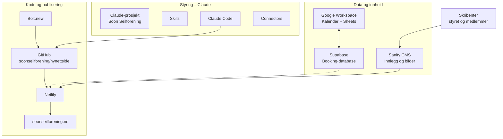

# Arkitektur – nettsiden til Soon Seilforening

Sist oppdatert: 22. november 2026

## Kort fortalt

**Claude styrer, GitHub lagrer, Netlify publiserer.** Innhold og data ligger i Sanity, Supabase og Google Workspace, og nettsiden henter det derfra.



## De tre lagene

### 1. Styring – Claude

| Del | Rolle |
|---|---|
| Claude-prosjektet *Soon Seilforening* | Fast arbeidsflate med prosjektinstruksjoner og prosjektkunnskap (dokumentene i `docs/`) |
| Skills | Faste arbeidsmåter, f.eks. nyhetsinnlegg, prisliste og bookingbehandling. En kopi av hver skill ligger i `skills/` |
| Claude Code | Gjør endringer i koden direkte i GitHub-repoet etter at første versjon er laget |
| Connectors | GitHub, Netlify, Supabase og Google Workspace. Sanity kobles til som egendefinert connector |

### 2. Kode og publisering

| Del | Rolle |
|---|---|
| Bolt.new | Bygger første versjon av nettsiden med AI og er koblet til GitHub |
| GitHub | Eneste sted koden ligger. Organisasjonen `soonseilforening` eier repoet `nettside` |
| Netlify | Bygger og publiserer nettsiden automatisk ved hver commit til `main` |
| soonseilforening.no | Domenet pekes til Netlify først ved lansering. Wix-siden er i drift fram til da |

### 3. Data og innhold

| Del | Rolle |
|---|---|
| Sanity CMS | Skribentene publiserer innlegg, blogg og bilder i Sanity Studio, og nettsiden henter innholdet derfra |
| Supabase | Database (Postgres) for bookinger og leietakere, pluss fillagring. Erstatter Wix CMS og Velo |
| Google Workspace | Google Kalender viser når lokalet er utleid. Bookingadministrasjonen gjøres i Google Sheets, som i dag |

## Flyt for innhold

1. En skribent logger inn i Sanity Studio og skriver et innlegg med bilder.
2. Skribenten publiserer innlegget.
3. Nettsiden henter innholdet fra Sanity, og innlegget blir synlig på soonseilforening.no.

Skribentene trenger verken GitHub, Netlify eller Claude.

## Flyt for booking av selskapslokalet

```
Forespørsel → behandling hos admin → kontrakt → kunden godtar → faktura (Unimicro) → fullført
                                       └──────────── avbestilling ────────────┘
```

1. Kunden sender en forespørsel via skjemaet på nettsiden. Forespørselen lagres i Supabase.
2. Forespørselen sendes videre til bookingarket i Google Sheets.
3. Admin endrer status (og eventuelt dato) i arket.
4. Endringen sendes tilbake til Supabase, slik at ledigheten på nettsiden og i Google Kalender stemmer.
5. Fakturaen lages i Unimicro.

Detaljene skal dokumenteres i `docs/bookingflyt.md`. Tabeller og felt skal dokumenteres i `docs/datamodell.md`.

## Hemmeligheter og personvern

- API-nøkler og tokens ligger som miljøvariabler i Netlify og Supabase. `.env.example` viser bare navnene.
- Personopplysninger om leietakere og medlemmer ligger bare i Supabase og Google Workspace, aldri i repoet.
- Alle tjenester skal ha minst to administratorer fra styret.

## Beslutninger

| Dato | Beslutning | Begrunnelse |
|---|---|---|
| 2026-11-22 | Ny nettside bygges utenfor Wix | Mer fleksibelt, og koden eies av foreningen |
| 2026-11-22 | GitHub-organisasjonen `soonseilforening` eier koden | Gjør det mulig for andre frivillige å overta |
| 2026-11-22 | Netlify for hosting | Automatisk publisering fra GitHub og innebygd integrasjon med Bolt.new |
| 2026-11-22 | Supabase som database | Bolt.new kan koble seg til den direkte, og den har gratisnivå |
| 2026-11-22 | Sanity som publiseringsløsning | Lett å bruke for de som ikke er tekniske, har god bildehåndtering og 20 gratis redaktørplasser |
| 2026-11-22 | Bookingadministrasjonen blir i Google Sheets | Fungerer allerede, og admin kjenner verktøyet |

Nye beslutninger føres inn i `docs/beslutninger.md`.

## Åpne spørsmål

- Hvilke sider og hvilket innhold skal flyttes fra dagens Wix-side?
- Skal medlemmene kunne logge inn på nettsiden?
- Når skal domenet flyttes til Netlify?
