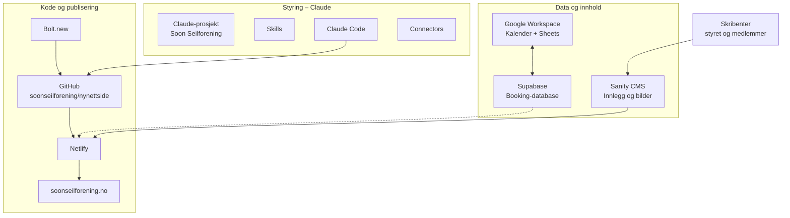

# Arkitektur – nettsiden til Soon Seilforening

Sist oppdatert: 23. november 2026 (kveld)

## Kort fortalt

**Claude styrer, GitHub lagrer, Netlify publiserer.** Innhold og data ligger i Sanity, Supabase og Google Workspace, og nettsiden henter det derfra.



## De tre lagene

### 1. Styring – Claude

| Del | Rolle |
|---|---|
| Claude-prosjektet *Soon Seilforening* | Fast arbeidsflate med prosjektinstruksjoner og prosjektkunnskap (dokumentene i `docs/`) |
| Skills | Faste arbeidsmåter, f.eks. nyhetsinnlegg, prisliste og bookingbehandling. En kopi av hver skill ligger i `skills/` |
| Claude Code | Gjør endringer i koden direkte i GitHub-repoet etter at første versjon er laget |
| Connectors | GitHub, Netlify, Supabase og Google Workspace. Sanity kobles til som egendefinert connector |

### 2. Kode og publisering

| Del | Rolle |
|---|---|
| Bolt.new | Bygde første versjon av nettsiden (avsluttet 23.11.2026). Videre endringer gjøres av Claude direkte i GitHub |
| GitHub | Eneste sted koden ligger. Organisasjonen `soonseilforening` eier repoet `nynettside` |
| Netlify | Bygger og publiserer nettsiden automatisk ved hver commit til `main` |
| soonseilforening.no | Domenet pekes til Netlify først ved lansering. Wix-siden er i drift fram til da |

### 3. Data og innhold

| Del | Rolle |
|---|---|
| Sanity CMS | Skribentene publiserer innlegg, blogg og bilder i Sanity Studio, og nettsiden henter innholdet derfra |
| Supabase | Database (Postgres) for bookinger og leietakere, pluss fillagring. Erstatter Wix CMS og Velo |
| Google Workspace | Google Kalender viser når lokalet er utleid. Bookingadministrasjonen gjøres i Google Sheets, som i dag |

## Nettsiden i dag (første versjon fra Bolt)

### Teknologi

| Del | Hva det er |
|---|---|
| React + TypeScript | Rammeverket som brukergrensesnittet er bygget i |
| Vite | Byggverktøy. Lager de ferdige filene som Netlify publiserer |
| Tailwind CSS | Styling. Profilfarge `#0C1C8C` og hvit bakgrunn på alle sider |
| Lucide React | Ikoner |
| React Router | Gir hver side sin egen adresse, f.eks. `/utleie`. *Legges til i neste steg* |

### Sider

Hver side har sin egen adresse (React Router). Filen `public/_redirects` sørger for at direkte lenker til undersider fungerer på Netlify.

| Side | Adresse | Innhold |
|---|---|---|
| Hjem | `/` | Velkomst, vær (lenker til Windy og Yr), kommende aktiviteter og siste nyheter |
| Aktiviteter | `/aktiviteter` | Seilas, trening, dugnad og regattaer |
| – Seilkurs | `/aktiviteter/seilkurs` | Kurs for barn og voksne, sommer-seilskole |
| Utleielokale | `/utleielokale` | Lokalet Neptun: tekst, priser og bilder fra `content/tekster/utleielokale.md`. Bookingskjemaet kommer senere |
| Gjestebrygge | `/gjestebrygge` | For gjester og faste bryggeplasser (`content/tekster/gjestebrygge.md`) |
| Medlemskap | `/medlemskap` | Kontingent, innmelding og utmelding (tekst fra `content/tekster/medlemskap.md`) |
| Nyheter | `/nyheter` | Nyhetsartikler |
| Om oss | `/om-oss` | Om foreningen (tekst fra `content/tekster/om-oss.txt`), kontakt og «Våre grupper» |
| – Styret og kontoret | `/om-oss/styret` | Navn, rolle, bilde og funksjonsadresse for styret og kontormedarbeider (`content/tekster/styret.md`) |
| – Jolle | `/om-oss/jolle` | Gruppeside |
| – Kjølbåt-Sport | `/om-oss/kjolbat-sport` | Gruppeside |
| – Ladies Sailing | `/om-oss/ladies-sailing` | Gruppeside (navnet skal avklares med gruppeleder) |
| – Drake | `/om-oss/drake` | Gruppeside |

Sider merket med «–» er undersider og vises som underpunkter i menyen. Adressene bruker bare ASCII-tegn (`kjolbat`, ikke `kjølbåt`).

Gruppesidene bruker én felles komponent (`src/pages/GroupPage.tsx`), og dataene for alle gruppene ligger i `src/siteConfig.ts`. Gruppelederne skriver tekstene, som legges i `content/tekster/` før de settes inn.

Medlemsportal: Innlogging og innmelding går via lenker til Rubic (foreningens medlemssystem). Nettsiden lagrer ingen medlemsdata selv.

### Hvor innholdet ligger nå (midlertidig)

Nyheter, arrangementer, grupper og lenker ligger foreløpig **hardkodet i konfigurasjonsfilen** `src/siteConfig.ts`. Det betyr at endringer i innhold krever en endring i koden.

Bilder ligger i `content/bilder/<side>/` og kopieres til `public/bilder/<side>/` når de brukes på nettsiden.

Innhold vi ikke har fasit for ennå (priser, kapasiteter, fasiliteter, arrangementer, nyheter og gruppetekster), er merket «[EKSEMPEL – må fylles inn]» på nettsiden. Fasittekster legges i `content/tekster/`.

Dette er en bevisst mellomløsning:

1. **Nå:** Innholdet ligger i konfigurasjonsfilen.
2. **Når Sanity er satt opp:** Nyheter og arrangementer flyttes til Sanity, og skribentene kan publisere selv.
3. **Når bookingen bygges:** Nettsiden kobles til foreningens eget Supabase-prosjekt.

### Database i Bolt brukes ikke

Bolt tilbyr sin egen database («Bolt Database»), som er en Supabase-database som styres via Bolt-kontoen. **Den skal ikke brukes.** Foreningen skal ha et eget Supabase-prosjekt som eies av foreningen og har minst to administratorer fra styret. Da kan andre frivillige overta, og dataene er ikke knyttet til én persons Bolt-konto.

Pakken `@supabase/supabase-js` ligger allerede i prosjektet og kan brukes mot foreningens eget Supabase-prosjekt når bookingen bygges.

## Flyt for innhold

1. En skribent logger inn i Sanity Studio og skriver et innlegg med bilder.
2. Skribenten publiserer innlegget.
3. Nettsiden henter innholdet fra Sanity, og innlegget blir synlig på soonseilforening.no.

Skribentene trenger verken GitHub, Netlify eller Claude.

Oppsett, felter og drift av Sanity er beskrevet i `docs/sanity.md`. Koden for Sanity Studio ligger i `/studio`.

## Flyt for booking av selskapslokalet

```
Forespørsel → behandling hos admin → kontrakt → kunden godtar → faktura (Unimicro) → fullført
                                       └──────────── avbestilling ────────────┘
```

1. Kunden sender en forespørsel via skjemaet på nettsiden. Forespørselen lagres i Supabase.
2. Forespørselen sendes videre til bookingarket i Google Sheets.
3. Admin endrer status (og eventuelt dato) i arket.
4. Endringen sendes tilbake til Supabase, slik at ledigheten på nettsiden og i Google Kalender stemmer.
5. Fakturaen lages i Unimicro.

Detaljene skal dokumenteres i `docs/bookingflyt.md`. Tabeller og felt skal dokumenteres i `docs/datamodell.md`.

## Hemmeligheter og personvern

- API-nøkler og tokens ligger som miljøvariabler i Netlify og Supabase. `.env.example` viser bare navnene.
- Personopplysninger om leietakere og medlemmer ligger bare i Supabase og Google Workspace, aldri i repoet.
- Alle tjenester skal ha minst to administratorer fra styret.

## Beslutninger

| Dato | Beslutning | Begrunnelse |
|---|---|---|
| 2026-11-22 | Ny nettside bygges utenfor Wix | Mer fleksibelt, og koden eies av foreningen |
| 2026-11-22 | GitHub-organisasjonen `soonseilforening` eier koden | Gjør det mulig for andre frivillige å overta |
| 2026-11-22 | Netlify for hosting | Automatisk publisering fra GitHub og innebygd integrasjon med Bolt.new |
| 2026-11-22 | Supabase som database | Bolt.new kan koble seg til den direkte, og den har gratisnivå |
| 2026-11-22 | Sanity som publiseringsløsning | Lett å bruke for de som ikke er tekniske, har god bildehåndtering og 20 gratis redaktørplasser |
| 2026-11-22 | Bookingadministrasjonen blir i Google Sheets | Fungerer allerede, og admin kjenner verktøyet |

Nye beslutninger føres inn i `docs/beslutninger.md`.

Sjekklisten for lansering ligger i `docs/lansering.md`.

## Åpne spørsmål

- Hvilket innhold skal flyttes fra dagens Wix-side til de nye sidene?
- Skal medlemmene kunne logge inn på nettsiden, eller holder det med lenker til Rubic?
- Når skal domenet flyttes til Netlify?
